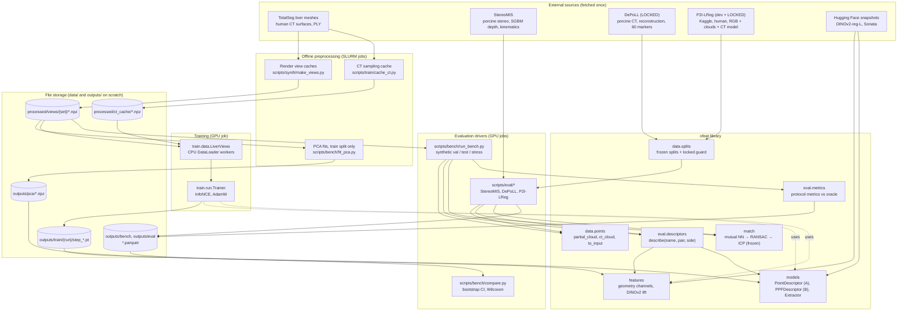
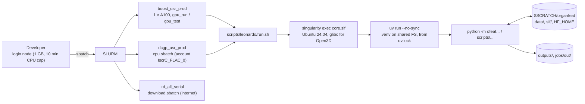
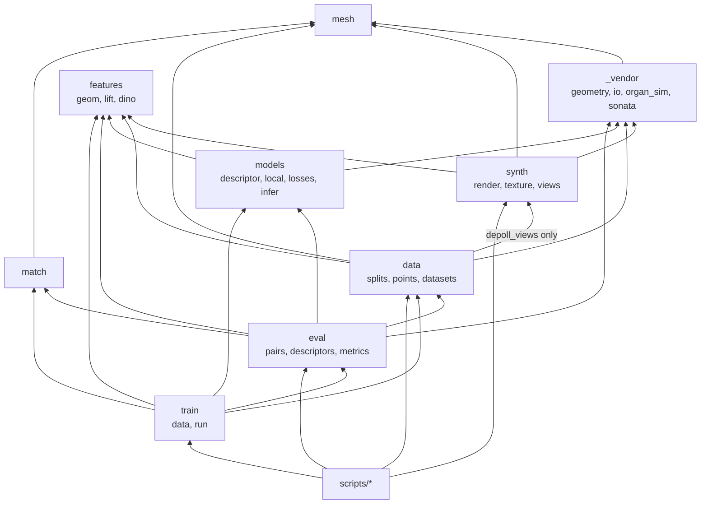
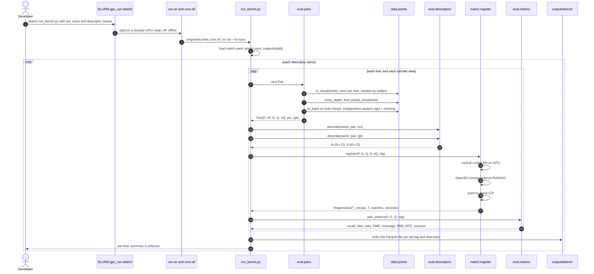
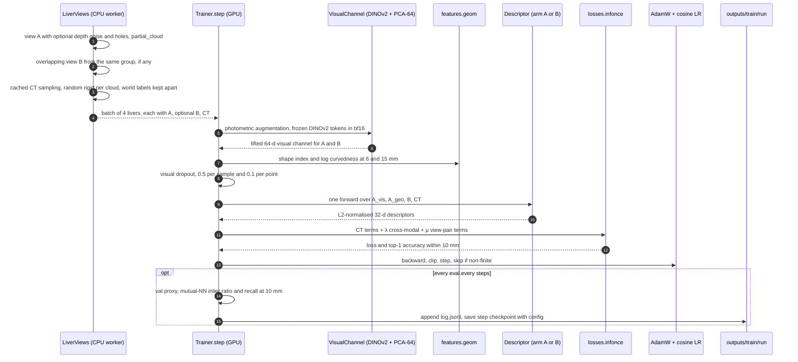

# Architecture

This document describes how `organfeat` (Python package `ofeat`) is built and how its parts fit together.
It covers subsystems, contracts and design decisions, not individual functions. For the research
question and the pre-registered rules the code enforces, read [`docs/protocol.md`](docs/protocol.md).
For day-to-day commands, read [`README.md`](README.md).

---

## 1. System overview

### Purpose
The repository is a **research benchmark and training codebase**. It asks one question: do
self-supervised per-point descriptors that combine **surface geometry** with **frozen DINOv2 image
features lifted onto visible points** improve rigid matching of a *partial, visible liver surface*
(a laparoscopic view) to the *complete CT surface* of the same liver? The CT side has no appearance.

The descriptor is the **only variable**. Everything around it is fixed before any training: point
sampling, the matching pipeline (mutual nearest neighbours → RANSAC → ICP), the metrics, the data
splits and the selection rule. The system therefore has three jobs:

1. **Generate data with exact ground truth.** It renders synthetic laparoscopic views of human CT
   livers (TotalSegmentator) with exact per-pixel surface correspondences.
2. **Train descriptors.** A Sonata/PTv3 encoder (arm A) or a strictly local PPF-PointNet (arm B) is
   trained with a multi-positive InfoNCE loss. It sees an optional visual channel and a learned
   *missing* token for the CT side.
3. **Score any descriptor the same way.** Baselines and learned models go through the same frozen
   pipeline on synthetic val/test/stress sets and on three real datasets: StereoMIS, plus DePoLL
   and P2I-LReg, which are **locked**.

It runs as a batch system: there is no server, database or long-running service. Every step is a
SLURM job on the CINECA **Leonardo** cluster that reads and writes files.

### Technology stack

| Layer | Technology |
|---|---|
| Language | Python 3.12 (`requires-python >=3.12,<3.13`), Bash for job launchers |
| Packaging / env | [uv](https://docs.astral.sh/uv/) (`pyproject.toml`, `uv.lock`), `uv_build` backend; local wheels for `flash-attn` and `nvdiffrast` in `wheels/` |
| Deep learning | PyTorch 2.9 (CUDA 12.8 index), torchvision; spconv (cu126), flash-attn, timm (PTv3 / Sonata stack) |
| Pretrained models | DINOv2 ViT-L/14 with registers (Hugging Face `transformers`), Sonata / Point Transformer V3 (vendored, weights from `facebook/sonata`) |
| Geometry | Open3D 0.20 (FPFH, correspondence RANSAC, ICP, raycasting, Poisson), trimesh, SciPy (KD-trees), plyfile |
| Rendering | nvdiffrast (GPU rasterisation) or Open3D raycasting (CPU), both feeding a shared NumPy shading pipeline |
| Image | OpenCV (headless), scikit-image |
| Config | OmegaConf YAML with dot-list overrides |
| Results / stats | pandas + pyarrow (Parquet), SciPy (Wilcoxon), NumPy bootstrap |
| Testing / lint | pytest, ruff (line length 110) |
| Infrastructure | Leonardo HPC: SLURM (booster A100 GPUs, DCGP CPU, serial partition for internet), Singularity image `core.sif` (Ubuntu 24.04) |
| Declared, not called from current code | `wandb` (`WANDB_MODE=offline` in `env.sh`), `rerun-sdk` (planned visual logs) |

---

## 2. High-level system architecture

### 2.1 Component view



**Reading the diagram**
- **Synthetic path (left).** TotalSeg meshes become rendered view caches and CT samplings. Training
  and benchmarking only read those caches, never the renderer.
- **Library (centre).** `ofeat` holds every piece of logic the protocol fixes. Point construction,
  the matcher and the metrics are shared by every driver, so no method gets its own preprocessing.
- **Drivers (right).** Training, the synthetic benchmark and the real-data evaluations are thin
  scripts on top of the library. They write Parquet rows; `compare.py` turns those into statistics.
- **Locked data** reaches a driver only through `data.splits.require_unlocked` (Section 6.3).

### 2.2 Runtime / deployment view



Compute nodes are offline (`HF_HUB_OFFLINE=1`). Weights are fetched beforehand into `$HF_HOME` or
`data/weights/`. Only the serial partition has internet; it runs downloads (Kaggle) and image builds.

---

## 3. Directory and module structure

### 3.1 Curated tree

```text
organfeat/
├── CONTEXT.md               one-page orientation (question, data roles, running on Leonardo)
├── ARCHITECTURE.md          this file
├── README.md                setup and workflows
├── pyproject.toml, uv.lock  uv project; torch from the cu128 index; local wheels for flash-attn / nvdiffrast
├── configs/
│   ├── match.yaml           FROZEN matching pipeline parameters
│   ├── points.yaml          FROZEN point sampling (3 mm voxels, caps, k-NN normals)
│   ├── splits/              FROZEN subject splits: totalseg_liver, stereomis, p2i_lreg
│   └── train/base.yaml      training config + selection grids (overridden by dot-list)
├── docs/                    plan, pre-registered protocol (+ Deviations), stage findings, P2I-LReg audit
├── ofeat/
│   ├── mesh.py              Mesh type; REPO and data_root() ($OFEAT_DATA or ./data)
│   ├── match.py             the fixed pipeline: match → ransac → icp → register()
│   ├── _vendor/             code copied from sibling projects (geometry, IO, ARAP sim, Sonata/PTv3)
│   ├── data/                splits + locked guard, point-cloud construction, dataset readers
│   ├── synth/               renderer, procedural textures, view-set generation
│   ├── features/            geometric channels, DINOv2 tokens, image → point lifting
│   ├── models/              descriptors (arm A / arm B), InfoNCE loss, inference Extractor
│   ├── train/               training dataset + training loop
│   └── eval/                benchmark pairs, descriptor registry, protocol metrics
├── scripts/
│   ├── leonardo/            env.sh, run.sh (container wrapper), sbatch launchers, image build
│   ├── download/            dataset copy / Kaggle download (run via download.sbatch)
│   ├── preprocess/          P2I-LReg format audit
│   ├── sanity/              ground-truth and convention checks
│   ├── synth/               render view caches per split and stress set
│   ├── train/               CT cache + stage launchers (S1 geometry, S2 multimodal, S3 ablations)
│   ├── bench/               synthetic benchmark, PCA fit, RANSAC bound, selection, statistics
│   └── eval/                real-data evaluations (StereoMIS, DePoLL, P2I-LReg)
├── tests/                   pytest unit tests (GPU / dataset tests skip when unavailable)
├── data/        → $SCRATCH  symlinks: raw/, processed/, weights/, sif/, cache/, tmp/   (gitignored)
├── outputs/                 PCA fits, checkpoints, benchmark / eval Parquet, audit sheets  (gitignored)
├── jobs/out/                SLURM logs, %x_%j.out                                           (gitignored)
└── wheels/                  prebuilt flash-attn and nvdiffrast wheels                       (gitignored)
```

### 3.2 Package responsibilities

| Package / module | Responsibility | Key contracts |
|---|---|---|
| `ofeat.mesh` | Core surface type and repo paths. | `Mesh(verts mm, faces, outward normals)`; `data_root()` resolves `$OFEAT_DATA`. |
| `ofeat.match` | **The frozen pipeline**: cosine mutual NN (GPU, chunked) → Open3D correspondence RANSAC → point-to-plane ICP. | `register(P, fs, Q, ft, nQ, cfg) -> Registration(T_ransac, T, matches, seconds)`. Parameters only from `configs/match.yaml`. |
| `ofeat.data.splits` | Loads frozen splits; **locked-set guard**. | `require_unlocked(name)` raises `LockedDatasetError` unless `OFEAT_UNLOCK_EVAL` names the set. |
| `ofeat.data.points` | Turns a view or a mesh into a matching input: common voxel sampling, k-NN PCA normals, depth-noise model, random rigid input transform. | `Cloud(xyz, normals, pix?, gt?)`; `partial_cloud(...)`, `ct_cloud(mesh)`, `to_input(cloud, T)`. |
| `ofeat.data.liver_meshes` | TotalSeg liver PLYs, filtered to status "ok" and ≥ 300 ml. | `subjects(split)`, `load(subject) -> Mesh`. |
| `ofeat.data.{stereomis, stereomis_frames}` | StereoMIS calibration, kinematic poses, rectified frames + SGBM depth + tool masks. | `load_frame(seq, frame) -> StereoFrame`. |
| `ofeat.data.{depoll, depoll_views}` | DePoLL markers, reference CT surface, coloured reconstruction rendered from 24 virtual views. **Locked.** | All entry points call `require_unlocked("depoll")`. |
| `ofeat.data.p2i_lreg` | P2I-LReg frames, CT model (m → mm), per-frame affine camera fit. **Dev + locked.** | `load_frame(case, frame)`, `fit_camera(frame)`. |
| `ofeat.data.liver_probe` | Frozen logistic-regression liver probe on DINOv2 patch tokens. It selects liver points on real frames. | `p_liver(probe, tokens)`, `patch_mask(...)`. |
| `ofeat.synth.render` | Laparoscope-like renderer with exact per-pixel ground truth (triangle id + barycentrics). It has two rasterisation backends and shared shading and nuisances. | `render(mesh, albedo, cam, nuisance, rng) -> Frame`. |
| `ofeat.synth.texture` | Random procedural 3-D liver albedo, redrawn per view group. Four training families; held-out `stripes` and `cells`; `flat`. | `random_texture(rng, lo, hi, families)`. |
| `ofeat.synth.views` | Renders all views of one liver: groups of overlapping views, view overlap matrix, optional ARAP deformation. | `render_liver(mesh, ViewConfig, seed) -> dict` (stored as one `.npz`). |
| `ofeat.features.geom` | Rotation-invariant geometry in torch: k-NN, PCA normals, quadric curvature, shape index / curvedness. | `geom_features(x, n, radii) -> (N, 4)`. |
| `ofeat.features.{dino, lift}` | Frozen DINOv2 patch tokens; back-projection; specular mask; bilinear lifting of tokens to pixels. | `DinoPatches()(rgb) -> (B, h, w, 1024)`; `lift(tokens, uv, size)`. |
| `ofeat.models.descriptor` | **Arm A**: Sonata encoder plus a zero-initialised adapter for `[geometry ‖ visual-or-missing]`, then a 32-d L2-normalised head. `build()` factory selects the arm. | `forward(xyz[], normals[], geom[], vis[]?, vis_ok[]?) -> [(N_i, 32)]`. |
| `ofeat.models.local` | **Arm B**: strictly local point-pair-feature PointNet (10 / 25 mm balls). | Same interface as arm A. |
| `ofeat.models.losses` | Multi-positive InfoNCE with a safe radius. | `infonce(za, zb, pa, pb, ...)`; positions are labels only. |
| `ofeat.models.infer` | **Deliverable**: checkpoint → per-point descriptors. Rebuilds the model from the config stored in the checkpoint. | `Extractor(ckpt)(xyz, normals, rgb=?, pix=?)`. |
| `ofeat.train.data` | Training samples: partial view A, overlapping view B, cached CT sampling. Each gets its own random rigid transform; true world positions are carried separately. | `LiverViews[i] -> {"A", "B"?, "CT"}` with `xyz, normals, world, pix?, rgb?`. |
| `ofeat.train.run` | Training loop: GPU photometric augmentation → frozen DINOv2 → losses → AdamW (two LR groups) → val proxy + checkpoint. | CLI `python -m ofeat.train.run --config base name=... key=value`. |
| `ofeat.eval.pairs` | Deterministic (partial view, CT) benchmark pairs from the view caches, in independent input frames. | `pairs(set, subjects, cfg, depth_noise=?) -> Iterator[Pair]`. |
| `ofeat.eval.descriptors` | **Descriptor registry**: every baseline and learned model behind one string-keyed function. | `describe(name, pair, side) -> (N, D) float32`. |
| `ofeat.eval.metrics` | Protocol metrics against the oracle rigid fit `kabsch(P, G)`. | `pair_metrics(P, G, Q, reg) -> dict`. |
| `ofeat._vendor` | Copied third-party / sibling-project code with origin headers. It includes the full Sonata/PTv3 source, which ruff excludes. | No imports of `../correspondences` or `../defreg`. |

### 3.3 Internal dependency layering

Arrows mean "imports". Lower layers never import upper ones. Scripts sit on top and are the only
place where datasets, descriptors and the matcher are put together for a run.



---

## 4. Core data flow and request lifecycle

There is no request or response cycle. The two critical paths are **scoring a descriptor** (every
number in the study comes from it) and **one training step**. A third path, the locked real-data
evaluation, reuses the first with a different pair source.

### 4.1 Critical path 1: scoring descriptors on synthetic pairs (`run_bench.py`)

1. **Launch.** `sbatch -J bench_val scripts/leonardo/gpu_run.sbatch python scripts/bench/run_bench.py --set val --sigma100 1 --holes 0.1 --desc fpfh_r20 learned:<ckpt>`.
   `gpu_run.sbatch` sets `HF_HUB_OFFLINE=1`. `run.sh` changes to the repo root and runs the command
   inside `core.sif` with `uv run --no-sync`.
2. **Configuration.** `match.load_config()` and `points.load_config()` read the frozen YAMLs. The
   split comes from the set name (`test_tools2` → `test`), and `liver_meshes.subjects(split)` lists
   the livers.
3. **Pair construction** (`eval.pairs.pairs`), per liver:
   - **CT cloud.** Area-uniform samples of the mesh at one point per 3 mm voxel, with PCA normals
     oriented along the mesh normals. The seed comes from `crc32("ct", subject)`. Deformed stress
     sets use the stored rest-pose mesh instead.
   - **Per cached view.** The exact depth is perturbed with the stereo-like noise model
     (σ ∝ z², smooth holes). `partial_cloud` then keeps organ pixels that are not tool, not specular
     and have observed depth. It back-projects them, voxel-samples them and computes camera-facing
     normals. `gt` holds each point's exact CT-frame position.
   - **Input frames.** Each cloud gets its **own** random SO(3) rotation and translation and is
     centred (`to_input`). The labels `G` are moved into the CT input frame.
4. **Describe.** `describe(name, pair, "src")` and `describe(name, pair, "tgt")` return `(N, D)` and
   `(M, D)` descriptors. Only the source side gets `rgb` / `pix`. For learned models, the
   `Extractor` computes geometric channels, lifts DINOv2 tokens through the fixed PCA-64 (when the
   model uses images) and runs the encoder with a fixed seed.
5. **Register** (`match.register`):
   1. Cosine mutual nearest neighbours on the GPU. The ratio-test confidence is kept for coverage
      curves only.
   2. Open3D correspondence RANSAC: n = 3, 7.5 mm, edge-length 0.9, 100 k iterations, seed 0.
   3. Point-to-plane ICP: 5 mm, 50 iterations.
6. **Measure** (`eval.metrics.pair_metrics`). Point recall and inlier ratio at 5 / 10 / 20 mm, FMR,
   coverage AUC, RRE / RTE / pose RMSE after RANSAC and ICP against the oracle `kabsch(P, G)`,
   success (pose RMSE after ICP < 10 mm), timings and peak memory.
7. **Persist.** One Parquet row per pair goes to `outputs/bench/<set>[_noise<σ>_holes<h>]/<desc>.parquet`.
   A per-liver summary (mean over views, then over livers) is printed to `jobs/out/<job>_<id>.out`.
8. **Compare.** `scripts/bench/compare.py --set <tag> --ref fpfh_r20` computes per-liver means,
   95 % bootstrap CIs over livers and paired Wilcoxon tests against a reference descriptor.



**Checkpoint selection uses the same path.** `scripts/bench/select.sh <run>` and
`score_ckpts.sh <ckpt>...` submit `run_bench.py --set val --sigma100 1 --holes 0.1` with
`learned:<ckpt>` names. A `:geo` suffix forces geometry-only inference.

### 4.2 Critical path 2: one training step (`ofeat.train.run`)

1. **Sample (CPU workers, `LiverViews`).** For each of the 4 livers in a batch:
   - Pick a cached train view A and maybe add depth noise and holes. Build its partial cloud.
   - Pick an overlapping partner B from the same view group (overlap ≥ 0.3) if one exists.
   - Pick one of the cached CT samplings, optionally cropped.
   - Give every cloud its own random rigid transform and centre it. Carry the true world positions
     separately as `world`.
   - Normals are computed on the CPU here: forked workers cannot re-initialise CUDA.
2. **Visual channel (GPU).** Images get photometric augmentation, then frozen DINOv2 (bf16,
   no grad). Tokens are lifted to each point's pixel and projected with the train-only PCA-64.
3. **Geometric channels.** Shape index and log curvedness at 6 and 15 mm, from a batched quadric fit.
4. **Modality dropout.** The whole visual channel is dropped for 50 % of samples, otherwise for
   10 % of points; dropped entries use the learned *missing* vector.
5. **Forward.** One batched forward over the clouds A_vis, A_geo, B and CT. The CT always uses the
   missing vector, so it shares a path with A_geo.
6. **Loss.** `L(A_vis, CT) + L(A_geo, CT) + λ·L(A_vis, A_geo) + μ·L(A, B)`. Each term is a
   multi-positive InfoNCE: positives within 4 mm, negatives beyond a 12 mm safe radius, 1024
   anchors, τ = 0.07.
7. **Optimise.** AdamW with two LR groups: the encoder at `encoder_lr`, and the head, adapter and
   missing token at `lr`. Cosine schedule with warmup, gradient clipping at 1.0. Non-finite losses
   are skipped.
8. **Checkpoint.** Every `eval.every` steps, a cheap val proxy (mutual-NN inlier ratio@10 and point
   recall@10 on fixed val pairs in the primary noise setting) is logged to `log.jsonl`, and
   `step_<k>.pt` is saved with the full resolved config. Final selection is **not** done here: it
   uses path 1.



### 4.3 Path 3: locked real-data evaluation (S4, run once)

`scripts/eval/depoll_eval.py` and `p2i_eval.py --split locked` only run with
`--export=ALL,OFEAT_UNLOCK_EVAL=<name>`. Otherwise the first loader call raises `LockedDatasetError`.
They replace the synthetic pair source and keep everything after it:

- **DePoLL.**
  - The coloured stereo reconstruction is Poisson-meshed and rendered from 24 virtual views.
  - The frozen DINOv2 liver probe selects liver pixels.
  - The same `partial_cloud`, `to_input`, `describe` and `register` follow.
  - The metric is marker TRE against the oracle rigid TRE.
- **P2I-LReg.**
  - The provided clouds are used as given.
  - The CT model is projected with a per-frame **affine** camera, fitted because the clouds are not
    pinhole back-projections.
  - Metrics: Dice and boundary distance against the annotated mask, next to the reprojection ceiling.
- **StereoMIS (not locked).**
  - Frame pairs from the same sequence, binned by kinematic camera translation.
  - Matching is partial ↔ partial, against pseudo ground truth from forward kinematics.

---

## 5. External integrations and data storage

### 5.1 What is (and is not) here
There is **no database, cache server, message queue or web API**. All persistence is files on the
Leonardo filesystems. The "integrations" are one-off downloads and pretrained-weight snapshots.

| External system | Used for | When / how |
|---|---|---|
| **Hugging Face Hub** | DINOv2 `facebook/dinov2-with-registers-large`, Sonata `facebook/sonata` | Fetched once into `$HF_HOME` and `data/weights/sonata`. Jobs run with `HF_HUB_OFFLINE=1`. |
| **Kaggle API** | P2I-LReg (`junezhou001/p2i-lreg`, 72.8 GB) | `sbatch -J dl_p2i_lreg scripts/leonardo/download.sbatch p2i_lreg` on the serial partition. Needs a user-placed `~/.kaggle` token, which scripts never read. |
| **Sibling project scratch** (`correspondences`) | TotalSeg meshes, StereoMIS extracts, DePoLL subset, liver probe, wheels, `core.sif` | `scripts/download/copy_local.sh`. Data is **copied, not linked**. |
| **PyTorch cu128 index, PyPI** | Python dependencies | `uv sync --frozen` inside the container on a login node. |
| **Docker Hub** (`ubuntu:24.04`) | Base of `core.sif` | `scripts/leonardo/build_core.sh`. Rootless sandbox build, then squashfs. |
| **SLURM (Leonardo)** | All compute | `scripts/leonardo/*.sbatch`; logs in `jobs/out/%x_%j.out`. |
| W&B / rerun | Declared dependencies | `WANDB_MODE=offline` is exported. Neither is called by the current code. |

### 5.2 Storage layout and data movement

`data/*` are symlinks to `$SCRATCH/organfeat`. Scratch is purged after 40 days without access.
`OFEAT_DATA` overrides the root in jobs.

| Location | Format | Written by | Read by |
|---|---|---|---|
| `data/processed/totalseg_meshes/{index.csv, liver/<s>.ply}` | PLY + CSV (mm) | copied once | `data.liver_meshes` |
| `data/raw/{depoll, stereomis, p2i_lreg}` | dataset-native (PLY, YAML, PNG, OBJ, kinematics txt) | copy / download jobs | `data.depoll`, `data.stereomis`, `data.p2i_lreg` |
| `data/processed/stereomis/<seq>/{left, depth, tool, meta.json}` | JPEG, f16 depth, masks | copied extracts | `data.stereomis_frames` |
| `data/processed/views/<set>/<subject>.npz` | per-liver NPZ: `rgb, depth, tool, K, E, group, family, vis_frac, overlap` (+ deformation GT) | `scripts/synth/make_views.py` (CPU, resumable) | `eval.pairs`, `train.data` |
| `data/processed/ct_cache/<subject>.npz` | `xyz (n, N, 3)`, `normals` (4 samplings / liver) | `scripts/train/cache_ct.py` | `train.data` |
| `data/weights/{sonata, liver_probe}` | HF snapshot, joblib | copied once | `_vendor.sonata_encoder`, `data.liver_probe` |
| `$HF_HOME` | HF snapshot | prefetch | `features.dino` |
| `outputs/pca/{dino64, sonata32}.npz` | `mean, components, explained` | `scripts/bench/fit_pca.py` (train split only) | `models.infer.VisualChannel`, `eval.descriptors` |
| `outputs/train/<run>/{config.yaml, log.jsonl, step_<k>.pt}` | YAML, JSON lines, torch `{"model", "config", "step"}` | `ofeat.train.run` | `models.infer.Extractor`, selection scripts |
| `outputs/bench/<set>[_noise…_holes…]/<desc>.parquet`, `ransac_bound.parquet` | one row per pair | `scripts/bench/*` | `scripts/bench/compare.py` |
| `outputs/eval/{stereomis, depoll, p2i}/…` | Parquet + JSON summaries | `scripts/eval/*` | write-up |
| `outputs/audit/`, `outputs/synth/` | CSV, JPEG contact sheets | audit / preview scripts | humans |

**Lifecycle.**
1. **Ingest** (once): copy and download into `data/raw` and `data/processed`.
2. **Cache.** Split-specific view caches and CT samplings, then PCA fitted on train renders and
   train CT clouds only.
3. **Train.** Read caches, write checkpoints.
4. **Score.** Read caches and checkpoints, write Parquet.
5. **Analyse.** `compare.py` reads Parquet.

Paths under `outputs/` are **relative to the working directory**. `run.sh` always changes to the
repo root first, so scripts must be launched through it or from the root.

---

## 6. Architectural patterns and key design decisions

### 6.1 One variable: a frozen pipeline with pluggable descriptors (Strategy + registry)
- `eval.descriptors.describe(name, pair, side)` is the single seam between "what is compared" and
  "how it is scored".
- The name is a small grammar: `fpfh_r<R>`, `sonata`, `sonata_pca32`, `<geom>+dino`,
  `learned:<ckpt>[:geo]`. Drivers therefore take a list of descriptors on the command line, and
  adding a method means adding one branch.
- `match.py`, `configs/match.yaml` and `configs/points.yaml` are **frozen**. The YAML values are
  mirrored in frozen dataclass defaults, and tests (`test_config_file_matches_defaults`) fail if
  they drift.
- **Tradeoff.** The pipeline was not tuned for any method, so it may be suboptimal for some.
  Fairness and pre-registration were chosen over peak numbers.
- **Consequence.** The RANSAC bound shows that the frozen RANSAC + ICP succeeds once ~3–5 % of
  matches are correct. Registration recall therefore saturates quickly. The primary endpoint was
  moved to a noisy setting (σ = 1 mm, 10 % holes), and correspondence metrics (inlier ratio,
  coverage) carry the image question.

### 6.2 Pre-registration as an architectural constraint
- `docs/protocol.md` fixes metrics, thresholds, selection (val only, primary setting) and test-once
  rules before results exist. Changes are appended under **Deviations** with a date and a reason.
- Several code paths exist to enforce it:
  - split-first caches
  - the locked guard
  - PCA fitted on train only
  - selection scripts hard-wired to `--set val --sigma100 1 --holes 0.1`
- **Treat these as invariants, not defaults.**

### 6.3 Fail-closed locked datasets (capability via environment)
- `LOCKED = ("depoll", "p2i_lreg")`. Every loader entry point for those sets calls
  `require_unlocked`, which raises unless `OFEAT_UNLOCK_EVAL` lists the set.
- The unlock is per dataset and per job (`sbatch --export=ALL,OFEAT_UNLOCK_EVAL=depoll`).
  Smoke modes run the pipeline but never print or save metrics.
- P2I-LReg is split into `dev` (freely loadable, format debugging only) and `locked`, at case
  granularity.

### 6.4 Leakage control lives in the data contract
- **Independent random rigid transforms.** Every cloud passes through `to_input` (a random SO(3)
  rotation plus translation, then centring) separately for each side. No canonical, scanner or RAS
  coordinate reaches a descriptor.
- **Labels separate from inputs.** Ground truth always travels next to the inputs, never inside
  them: `Cloud.gt`, the `world` fields in training samples, and `Pair.G` in the target input frame.
  It is used only in losses and metrics.
- **Identical sampling.** Both modalities use the same voxel sampling and the same normal estimator,
  so point density or normal noise cannot reveal the modality.
- **Textures are a nuisance.** They are redrawn per view group from seeds unrelated to vertex ids,
  and two families are held out entirely.
- **Visual signal stays physical.** The CT side never gets colour, and Hounsfield values are never
  used as appearance.

### 6.5 Missing modality by construction
- One shared encoder serves both sides. The visual channel is either lifted DINOv2-PCA-64 or a
  learned `missing` vector.
- The CT path is exactly the geometry-only path of the partial side. A unit test checks this
  equivalence.
- The adapter's last layer is **zero-initialised**, so arm A starts as plain pretrained Sonata.
  Visual-modality dropout trains the model to work without images.
- **Tradeoff.** Simple concatenation `[geometry ‖ DINO]` with zeros on the CT side is a provable
  no-op under cosine nearest neighbours (it adds a per-source constant). Images can only help if a
  model learns to map them into the geometry space, which is why fusion happens before the encoder.

### 6.6 Two architecture arms behind one factory
- `models.descriptor.build(model_cfg)` picks `arch: sonata` (arm A, pre-registered) or `arch: ppf`
  (arm B, added in S1). Both share the input channels, loss, dropout and `Extractor`.
- **Tradeoff observed in S1.**
  - Global context (Sonata) is more robust to depth noise.
  - Strict locality (PPF) is far more precise on clean data.
  - Images help the local arm much more (+19 % vs +3–5 % relative inlier ratio).
  - The image question is answered on both backbones.

### 6.7 Self-describing checkpoints and config overrides
- Training configs are OmegaConf YAML with dot-list overrides (`name=s2_mm_lam0 loss.lambda_cross=0`).
  Selection grids are written into the YAML before runs.
- Each checkpoint embeds its resolved config. `Extractor` rebuilds the right architecture, geometric
  radii and visual channel from it, with no external run registry.

### 6.8 Determinism and acknowledged non-determinism
- **Seeds come from names.** Examples: `crc32("ct", subject)`, `subject_id * 10 + set_salt`, and
  `[seed, view_set, subject, view]`. Caches are reproducible and resumable, and stress sets keep the
  same cameras as the base test set (separate RNG streams for textures and tools).
- **PTv3 reseeding.** PTv3 shuffles its serialisation order from the global torch RNG, so every
  inference call reseeds (`torch.manual_seed(0)`).
- **Remaining non-determinism.** Open3D's multithreaded RANSAC is still not deterministic run to
  run. The protocol therefore reports per-liver statistics, and gaps under ~3 points between single
  runs are not interpreted.

### 6.9 Vendoring over cross-repo imports
- Code from `correspondences` and `defreg` (and the full Sonata/PTv3 source) is **copied** into
  `ofeat/_vendor` or adapted in place, with origin headers.
- **Tradeoff.** Duplication and manual syncing, in exchange for a repository that is self-contained,
  reproducible and releasable on its own.

### 6.10 Portable rendering with two equivalent backends
- Rasterisation is either nvdiffrast (GPU) or Open3D raycasting (CPU). Both produce triangle ids +
  barycentrics, and everything after that is shared NumPy.
- Tests check that the backends agree and that a ground-truth vertex projects to its pixel.
- Large caches are rendered on CPU nodes (DCGP) with one process per liver. GPUs stay for training
  and scoring.

### 6.11 HPC-shaped infrastructure
- **Container.** Leonardo's host glibc is too old for Open3D 0.20, so code runs inside `core.sif`.
- **Environment outside the image.** The Python environment is *not* baked into the image:
  `.venv` is built on the shared filesystem from `uv.lock` (`run.sh uv sync --frozen`), and heavy
  CUDA extensions come only from prebuilt wheels.
- **Practical rules.**
  - Compute nodes are offline.
  - Login nodes have hard CPU and memory caps.
  - Downloads go through the serial partition.
  - Each pipeline stage is a separate, resumable job writing files.

### 6.12 Notable tradeoffs and lessons recorded in the code

| Decision | Why | Cost |
|---|---|---|
| fp32 training, head LR 1e-4 | bf16 + 1e-3 collapsed after warmup; under bf16, spconv runs fp16 kernels | Slower steps, more memory |
| Normals on CPU in DataLoader workers | Forked workers cannot re-initialise CUDA | CPU time per sample |
| Point caps 8192 / 32768 (raised from 4096 / 16384) | Keep CT and partial densities equal on large livers | More memory per pair |
| Livers < 300 ml excluded | Three "ok" meshes were 50–60 ml field-of-view fragments | 408 / 20 / 46 instead of 411 / 20 / 46 |
| Primary endpoint under depth noise | FPFH is at the ceiling on noise-free views | Noise-free becomes a secondary result |
| StereoMIS pairs binned by kinematic translation | The camera barely moves over fixed frame gaps | Fewer and less regular pairs |
| P2I-LReg affine camera per frame | Provided clouds are not pinhole back-projections with `CAM_K` | Reprojection ceiling (12–49 px) must be reported next to results |
| Synthetic human training, porcine real test | No paired real data with appearance on both sides | Shape and domain gap reported as a limitation |
| CWD-relative `outputs/` paths | Simple scripts | Must run from the repo root (`run.sh` does this) |
