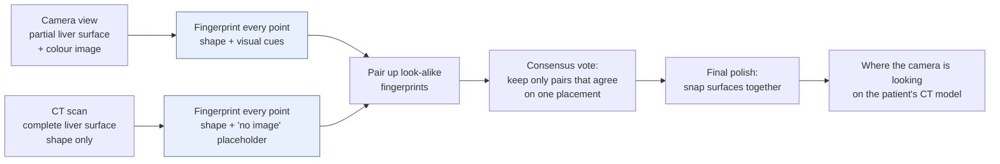
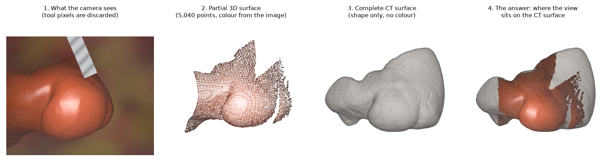
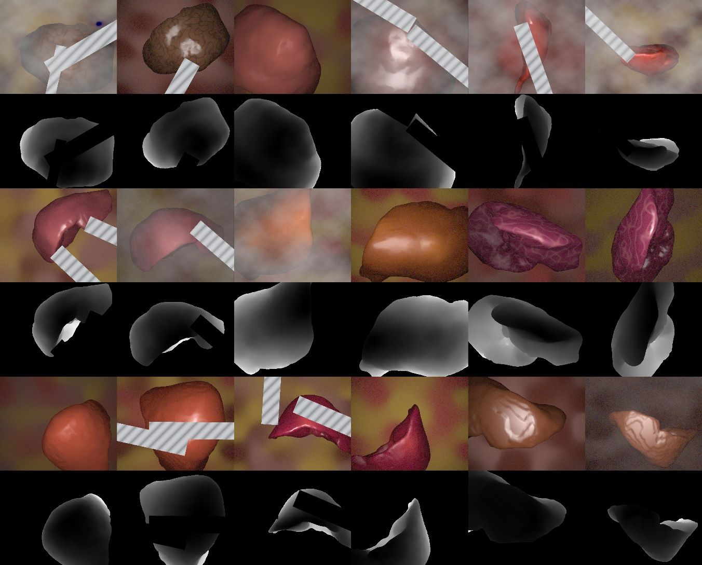
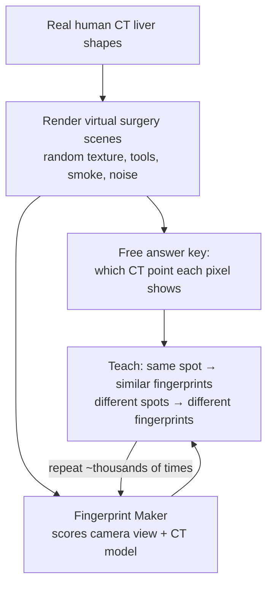
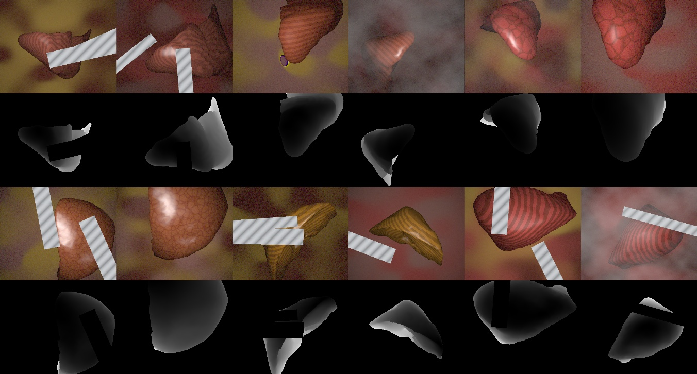

# organfeat: The Concept

*A plain-language guide to what this project does, why it exists, and how the idea works.
For the code layout, see `ARCHITECTURE.md`. For the rules of the study, see `docs/protocol.md`.*

---

## 1. The Executive Summary ("The Pitch")

**During keyhole liver surgery, the surgeon's camera sees only a small, glistening patch of the
liver. The hospital's CT scan, meanwhile, holds a complete 3D model of that same liver, but with
shape only, no colour.** This project teaches a computer to give every point on the liver a
compact "fingerprint". The fingerprint looks the same whether the point is seen through the camera
or on the CT model, so the camera's partial view can be snapped onto the right place on the full
model.

**The problem:** surgical navigation and augmented reality need to overlay hidden tumours and blood
vessels from the CT scan onto the live video. That overlay is only possible once the system knows
*where on the organ the camera is looking*. Livers are smooth and featureless, and the two data
sources speak different languages (colour photos vs. bare shape), so this first "where am I?" step
is hard and largely unsolved.

**For whom:** researchers and developers building image-guided surgery systems. More immediately,
it serves the sibling project that handles the second step, bending the CT model to match a
deformed organ. That project assumes someone has already solved the rough placement. This project
asks whether a realistic system can.

**The question it answers:** *Do learned fingerprints, enriched with what the camera image shows,
beat the standard hand-crafted approach at this matching task?* The study is set up so that
**"no" counts as a legitimate answer**.

---

## 2. The Mental Model & Conceptual Workflow

### The analogy: a hiker, a photo, and a blank relief map

Imagine a hiker holding a **photograph of a small stretch of hillside**: grass, shadows, a muddy
patch. They want to find that spot on a **plain white plaster relief model** of the whole mountain
range. The model has every ridge and valley, but no colours, no trees and no trails.

The hiker can't match colours, because the plaster has none. They have to:

1. **Describe each spot by its shape:** "a gentle slope curving into a ridge on the left".
2. **Use the photo's lighting as a clue to shape.** Shadows and highlights reveal slopes and edges
   even though the plaster has no shading painted on it.
3. **Pair up spots** in the photo with spots on the model that have similar descriptions.
4. **Vote:** most pairings will be wrong, but the correct ones all agree on *one* consistent
   placement of the photo on the model.
5. **Nudge** the photo into its exact final position.

This project builds a better version of steps 1 and 2: an automatic describer that writes a
"shape fingerprint" for every point. Steps 3–5 are deliberately kept standard and frozen.

### The end-to-end journey

| | What it means here |
|---|---|
| **Conceptual Input** | (a) A **partial 3D snapshot** of the liver surface, built from the surgical camera's depth estimate, plus the **colour image** behind it. (b) The **complete liver surface** from the patient's pre-operative CT scan, with shape only. The two arrive in unrelated orientations. |
| **The Transformation** | A trained model gives every point on both surfaces a short numeric fingerprint. On the camera side, it blends local 3D shape with visual cues lifted from a general-purpose image-understanding model. On the CT side, which has no image, it uses shape alone plus a learned "no image available" placeholder. Points with similar fingerprints are paired, a consensus vote discards the wrong pairs, and a final alignment step polishes the fit. |
| **Conceptual Output** | **The rigid placement (rotation + position) of the camera's view on the CT model**: where the camera is looking and how the organ is oriented. Downstream systems can then deform the model and overlay hidden anatomy on the live video. |

*Only the blue boxes change between contenders. The pairing, voting and polishing steps are
identical for every method tested.*

### What this looks like on one example

*One synthetic example (a validation liver that was never used for training):*
1. *The virtual camera image, with a surgical tool in view.*
2. *The partial 3D surface the method receives: about one point every 3 mm, coloured here by the
   image. Pixels hidden by the tool, and the brightest glare, are left out.*
3. *The complete CT liver: shape only. The method receives it as points at the same density.*
4. *The answer the system has to find: the camera's patch sits on the front of the liver.*

*Here both surfaces are drawn facing the same way so they are easy to compare. In the real task,
each one arrives in an arbitrary, unknown orientation. In synthetic data the answer is known
exactly; training and scoring both rely on that.*

<!-- Figures (synthetic renders of public TotalSegmentator liver shapes, made by this project):
     docs/img/synth_views_*.jpg: scripts/synth/make_views.py --set {val,test_tex_heldout} --preview N
     docs/img/concept_partial_vs_ct.png: scripts/synth/concept_figure.py (val liver s0607, view 3) -->

---

## 3. Key Conceptual Building Blocks

### 1. The Virtual Surgery Studio *(synthetic data factory)*
Real surgical videos almost never come with an exact answer key saying which CT point each pixel
shows. The studio makes its own. It takes 3D liver shapes from hundreds of real human CT scans and
films them with a virtual laparoscope from realistic angles and distances. It adds randomly
generated liver-like textures, surgical tools, smoke, glare, lens effects and depth-sensor noise.
Because every frame is rendered from the CT model, the studio knows *exactly* which point on the
model every pixel shows. That free, perfect answer key is what makes the rest of the project
possible. It also produces deliberately harder "stress" versions: noisier depth, unseen texture
styles, more tools, slightly deformed organs, and views that show less than a tenth of the liver.

*What the studio produces (three validation livers, never used for training). Each pair of rows is
one liver: six virtual laparoscope views on top, with the matching depth maps below (brighter =
farther; black = no surface or hidden by a tool). Viewpoint, texture, lighting, glare, smoke and
the striped grey surgical tools are all randomised. Behind every pixel sits the exact CT point it
shows.*

### 2. The Fingerprint Maker *(the learned descriptor)*
This is the one thing the project actually changes. It takes a cloud of 3D surface points and
writes a short fingerprint for each one. It comes in two designs that were tested head-to-head:
- a **"big-picture" design** that starts from a model pre-trained on a large collection of 3D scenes and
  looks at the whole visible surface at once;
- a **"magnifying-glass" design** that sees only a small neighbourhood around each point.

On the camera side, it can also take in visual cues from a frozen, general-purpose image model,
transferred from each pixel onto its 3D point. On the CT side, where there is no picture, a learned
"no image" placeholder fills that slot. The same model serves both sides, so it is forced to put
both into one shared "language of shape".

### 3. The Fixed Matchmaker *(frozen matching pipeline)*
This is a standard, off-the-shelf three-step process: pair up points whose fingerprints are mutual
best matches, run a consensus vote over many random trials to find the single placement most pairs
agree with, then polish the alignment surface-to-surface. It was **locked before any learning
began** and is identical for every method, from the decades-old hand-crafted baseline to the newest
trained model. Any difference in results can therefore be traced to the fingerprints alone.

### 4. The Referee *(pre-registered protocol and benchmark)*
The Referee is the rulebook, written down before any results existed. It fixes what counts as
success (e.g. landing within 1 cm), which data may be used for choosing the best model (a small
validation set only), and that the final test is scored once. Two real-world datasets are
**locked**: the software refuses to load them unless a final evaluation is explicitly unlocked.
Every rule change is logged with a date and a reason. Results are reported per liver, with
statistical confidence, so no one can fool themselves by cherry-picking.

### 5. The Reality Check *(real-world evaluation)*
Synthetic success means little if it doesn't survive real surgery. The Reality Check runs the
finished fingerprints on three kinds of real data:
- **real stereo surgical video of pigs**, with no CT, where the test is whether consecutive frames
  match each other consistently;
- **a locked pig dataset** with CT scans and implanted markers;
- **a locked human dataset** of real liver surgeries with matching pre-operative CT models.

Post-hoc comparisons against two published benchmarks are now being added. Nothing is tuned on
them.

---

## 4. The Machine Learning

### The Problem It Solves: why not simple rules?

- **Livers are smooth and repetitive.** A hand-crafted shape signature (the long-standing
  industry baseline) describes each point by measuring how the surface bends nearby. On a smooth,
  rounded organ, many different spots bend almost the same way, so those signatures are ambiguous.
  They get worse as depth noise grows.
- **The two sides speak different languages.** The camera sees colour, shine and shading. The CT
  model has only shape. No simple rule says "this pinkish glare corresponds to that curvature".
  Any link between appearance and shape has to be *learned*.
- **The camera sees only a fragment.** Typically only about a fifth of the liver's surface is visible,
  sometimes less than a tenth, often with tools in the way. Robust matching needs a describer that knows which surface cues stay stable across
  viewpoints, noise and occlusion. That kind of judgment can be learned, but it is hard to write
  as rules.

### What the Model Learned From

- **No human labels at all.** Training is *self-supervised*: the answer key comes for free from
  the Virtual Surgery Studio.
- **Source shapes:** **408 human livers** from a public CT segmentation collection. A further 20
  livers were kept for model selection and 46 for final testing, never seen during training.
- **Training views:** each training liver was filmed from **48 random laparoscopic viewpoints**,
  about 20,000 rendered surgical scenes. Every scene had fresh random textures, lighting, tools,
  smoke and depth noise.
- **Borrowed knowledge:** two frozen or lightly adapted foundation models. One is a
  general-purpose image model that already "understands" photos. The other is a 3D model
  pre-trained on large collections of real-world 3D scans.
- **The lesson it was taught:** "this point in the camera view and that point on the CT model are
  the same physical spot, so make their fingerprints match; these other points are elsewhere on the
  organ, so keep theirs apart." Points that are merely *very close* neighbours are not counted as
  wrong answers, because a smooth surface makes them nearly indistinguishable.

### What the Model Predicts

For every point on a surface, the model outputs a **32-number fingerprint**. The intuition:

> *Two fingerprints are close if, and only if, they describe the same physical spot on the liver,
> no matter which side they came from (camera or CT), how the organ is rotated, how noisy the depth
> is, or what colour the tissue happens to be.*

The model does **not** predict the final placement directly. It only produces fingerprints, and
the frozen matchmaker turns those into a placement. That separation is what makes the comparison
fair.

---

## 5. What Makes This Solution Unique

### Insight 1: "The fingerprint is the only variable": research designed like a clinical trial
Most matching papers tune everything at once (sampling, matching, voting, refinement) and then
credit the new feature. Here, everything except the fingerprint was **frozen and pre-registered
before training began**. The final real-world tests were **locked behind a software guard** and run
exactly once. The result is evidence you can trust, including the parts that are bad news.

### Insight 2: Images on only one side, and why the obvious fix does nothing
The camera has pictures; the CT doesn't. The tempting shortcut is to glue image features onto the
shape fingerprint and leave the CT's image slot empty. Under the matching rule used here, that
shortcut is **mathematically guaranteed to change nothing**: the glued-on part shifts every
comparison equally and never changes which point matches best. Images can help only if the model
learns to **translate visual cues into the language of shape**, so this project fuses them *before*
the fingerprint is formed. The finding: images helped, and the gain held on unseen texture styles
and even on untextured livers. So the model wasn't recognising tissue patterns. It was reading
**shading and outlines as evidence about shape**, like the hiker reading shadows on the hillside.

### Insight 3: You only need a few right answers
An early experiment measured how good fingerprints actually need to be. The consensus vote recovers
the correct placement once just **3–5 % of the proposed point pairs are correct**. That reframes the
goal: instead of near-perfect point-to-point correspondence, which an earlier sibling project tried
and failed at, you need a small but reliable core of correct pairs. Knowing this bar also explains
why the headline success rate saturates quickly, and why the study leans on finer-grained quality
measures to judge the image effect.

### Insight 4: Perfect answer keys from synthetic data, with leak-proofing
Rendering from CT gives exact ground truth for free, but synthetic data can let a model "cheat".
The design closes those loopholes:
- every surface is randomly rotated and moved on its own, so position can't give away the match;
- both sides are sampled identically, so point density can't reveal which side is which;
- textures are randomised and two whole texture families are held back, so the model can't memorise
  colours;
- the CT side never gets fake colour.

*The held-back texture styles, stripes and cell-like patterns, on two test livers. Training used
only cloudy, blotchy, vessel-like and smooth textures. The learned fingerprints kept their
accuracy on these unseen styles, and the image benefit was unchanged, which is evidence that the
model reads shape cues rather than memorising tissue patterns.*

### The core trade-off: big-picture vs. magnifying glass
The two fingerprint designs exposed a real tension:
- **The big-picture design** is more robust to noisy depth in simulation, but it *did not survive
  the jump to real video*: its fingerprints partly collapsed.
- **The magnifying-glass design** is sharper on clean data, gains the most from images (about +20 %
  correspondence quality vs. +3 %), and **did transfer to real surgical video**. There it beat the
  hand-crafted baseline, and images raised its match quality by 30–70 %.

The lesson for product direction: in a domain where training is synthetic and deployment is real,
**local, simpler features may generalise better than powerful global ones**.

---

## 6. Where It Stands Today (honest scorecard)

| Arena | Result |
|---|---|
| **Synthetic test** (46 unseen livers) | Learned fingerprints place the view correctly **99–100 %** of the time vs. **67 %** for the hand-crafted baseline. They hold up under every stress test (92–100 %), while the baseline falls to 32–72 %. |
| **Real stereo surgical video** (pigs) | The magnifying-glass design transfers and beats the baseline (57 % vs. 46 %), and images help. The big-picture design falls below the baseline. |
| **Locked real pig CT dataset** | **No method works, the baseline included.** The camera reconstructions were tiny, pig livers differ in shape from the human training livers, and the organ was deformed. |
| **Locked real human CT dataset** | All methods score about the same, and none beats *random* fingerprints fed through the same pipeline. The dataset's depth data and scoring method can't tell the methods apart. |

**Bottom line:** the idea is clearly validated in simulation and partly validated on real video. It
is **not yet proven for clinical CT registration**, and the project says so plainly.

**Deliverables:**
1. a reusable fingerprint extractor;
2. a benchmark for "images on one side only" matching;
3. a fully documented study that shows where the approach works and where it doesn't.
